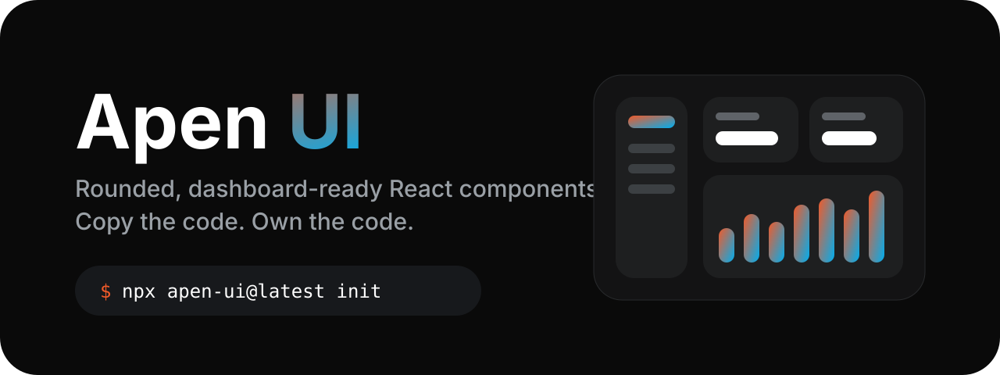

<p align="center">
  <a href="https://github.com/ibrarli/apen-ui">
    
  </a>
</p>

<p align="center">
  <a href="https://www.npmjs.com/package/apen-ui"></a>
  <a href="https://www.npmjs.com/package/apen-ui"></a>
  =20" src="https://img.shields.io/badge/node-%3E%3D20-339933?logo=node.js&logoColor=white">
  <a href="LICENSE"></a>
</p>

<p align="center">
  <a href="#quick-start">Quick start</a> ·
  <a href="#components">Components</a> ·
  <a href="#cli">CLI</a> ·
  <a href="#theming">Theming</a> ·
  <a href="https://www.apenapps.com">apenapps.com</a>
</p>

---

```bash
npx apen-ui@latest init
npx apen-ui@latest add button card sidebar
```

Apen UI is a set of rounded, dashboard-ready React components in the Apen Apps style. It works like [shadcn/ui](https://ui.shadcn.com): there is no component library to install. The CLI copies each component's source into your project, so you own the code and can change anything.

- **Rounded by design:** pill buttons, inputs and tabs, `rounded-3xl` cards, tonal surfaces and the Apen orange-to-blue gradient.
- **Dashboard ready:** a collapsible sidebar, a floating navbar, stat cards and data tables come built in.
- **Add one at a time:** `add sidebar` brings in `button` and `tooltip` because the sidebar uses them, and nothing else.
- **Familiar API:** the same composition, `data-slot` attributes and CSS variable names as shadcn/ui, with Radix underneath for accessibility.
- **Built on:** React 19, Tailwind CSS v4, Radix UI, class-variance-authority and [apen-icons](https://www.npmjs.com/package/apen-icons).

Built by [Apen Apps](https://www.apenapps.com). Pairs with [create-apen](https://github.com/ibrarli/create-apen), which scaffolds full-stack projects.

## Quick start

You need a React project with Tailwind CSS v4 (Next.js, Vite or React Router). For a new project, run `npx create-apen@latest` and choose Tailwind, or `npx create-next-app@latest`.

```bash
npx apen-ui@latest init
# or
pnpm dlx apen-ui@latest init
yarn dlx apen-ui@latest init
bunx --bun apen-ui@latest init
```

`init` will:

- write `apen.json` with your import aliases,
- add the `cn()` helper to `lib/utils.ts`,
- add the Apen theme tokens (light and dark) to your global CSS,
- install `clsx`, `tailwind-merge` and `tw-animate-css` with the package manager you already use.

Then add components and use them:

```bash
npx apen-ui@latest add button stat-card
```

```tsx
import { Button } from "@/components/ui/button"

export default function Page() {
  return <Button variant="brand">Get started</Button>
}
```

The theme uses **Quicksand** for headings and **Plus Jakarta Sans** for text. Load them with `next/font` and expose them as `--font-quicksand` and `--font-jakarta`. Without them, it falls back to your system font.

## Components

| Category | Components |
| --- | --- |
| Dashboard | `sidebar`, `navbar`, `stat-card` |
| Forms | `button`, `input`, `textarea`, `label`, `checkbox`, `switch`, `select` |
| Display | `card`, `table`, `badge`, `avatar`, `skeleton`, `progress`, `separator` |
| Feedback | `alert`, `tooltip` |
| Overlays | `dialog`, `dropdown-menu` |
| Navigation | `tabs` |

Run `npx apen-ui list` to see them in the terminal, or `npx apen-ui add --all` to add everything.

A dashboard in a few lines:

```tsx
import { SidebarInset, SidebarProvider, SidebarTrigger } from "@/components/ui/sidebar"
import { StatCard, StatCardLabel, StatCardTrend, StatCardValue, StatCardFooter } from "@/components/ui/stat-card"
import { AppSidebar } from "./app-sidebar"

export default function Dashboard() {
  return (
    <SidebarProvider>
      <AppSidebar />
      <SidebarInset className="gap-6 p-6">
        <SidebarTrigger />
        <StatCard>
          <StatCardLabel>Revenue</StatCardLabel>
          <StatCardValue>$48,290</StatCardValue>
          <StatCardFooter>
            <StatCardTrend trend="up">12.4%</StatCardTrend> vs last month
          </StatCardFooter>
        </StatCard>
      </SidebarInset>
    </SidebarProvider>
  )
}
```

The complete example lives in [`apps/www/app/dashboard`](apps/www/app/dashboard).

## CLI

```
npx apen-ui <command> [options]

init                  set up apen.json, the cn() helper and the theme tokens
add [components...]   add components and everything they depend on
list                  list every available component

-c, --cwd <path>      the project directory
-y, --yes             accept defaults / skip prompts
-o, --overwrite       (add) overwrite files that already exist
-a, --all             (add) add every component
-p, --path <path>     (add) write components to a different folder
-f, --force           (init) set everything up again
--no-install          do not install dependencies
-r, --registry <url>  use a hosted registry instead of the bundled one
```

Files you already have are never overwritten unless you pass `--overwrite`. Imports are rewritten to the aliases in `apen.json`, so `@/lib/utils` becomes `~/lib/utils` if that is what your project uses.

`apen.json`:

```json
{
  "tsx": true,
  "rsc": true,
  "css": "app/globals.css",
  "aliases": {
    "components": "@/components",
    "ui": "@/components/ui",
    "utils": "@/lib/utils"
  }
}
```

The registry ships inside the CLI, so it works offline and always matches the CLI version. The docs site also serves it at `/r/index.json` and `/r/<name>.json`. Use `--registry <url>` or the `APEN_UI_REGISTRY` environment variable to install from a hosted copy.

## Theming

All colours, radii and fonts are CSS variables with shadcn/ui names, so existing themes and know-how carry over.

The easiest way to make your own theme is the **theme customizer** on the docs site (`/themes`): pick a primary colour, the gradient, a neutral palette (Apen gray, Slate, Zinc, Stone), the radius and the heading and body fonts. The page updates live in light and dark mode, then you copy the generated CSS and the `next/font` setup.

Or override variables by hand after the theme block:

```css
:root {
  --primary: #00aeef; /* blue as the main colour */
  --radius: 0.75rem;  /* a little less round */
}
```

| Variable | Used for |
| --- | --- |
| `--primary` | main actions, active states, focus rings (`#f15a29`) |
| `--brand-orange`, `--brand-blue` | the Apen gradient (`bg-brand-gradient`, `text-brand-gradient`) |
| `--background`, `--foreground` | page colour and text |
| `--card`, `--muted`, `--accent` | tonal surfaces, quiet fills, hover backgrounds |
| `--border`, `--input` | hairlines and form borders |
| `--success`, `--warning`, `--destructive`, `--info` | status colours |
| `--sidebar*` | sidebar surface, hover and border |
| `--radius` | base radius; cards use 2×, menus 1.5× |
| `--font-body`, `--font-display` | text and heading fonts (default Plus Jakarta Sans and Quicksand) |

Dark mode uses a `.dark` class on `<html>`.

## Development

This repository is a pnpm workspace:

```
apen-ui/
├── packages/
│   ├── ui/                    # source of every component (the registry)
│   │   ├── src/ui/            # one file per component
│   │   ├── src/lib/utils.ts   # cn()
│   │   ├── src/styles/apen.css
│   │   ├── registry.mjs       # names, categories and descriptions
│   │   └── scripts/build-registry.mjs
│   └── cli/                   # the apen-ui CLI published to npm
└── apps/
    └── www/                   # docs site, examples and the dashboard demo
```

```bash
git clone https://github.com/ibrarli/apen-ui
cd apen-ui
pnpm install
pnpm dev                       # docs site on http://localhost:3000
pnpm registry:build            # rebuild the JSON registry
pnpm --filter apen-ui test     # build the CLI and run its smoke test
pnpm build                     # registry, CLI and docs
```

### Adding a component

1. Create `packages/ui/src/ui/<name>.tsx`. Import helpers as `@/lib/utils` and other components as `@/components/ui/<name>`, exactly as a user's project would.
2. Add an entry to `packages/ui/registry.mjs` with a category and description. npm and component dependencies are read from the imports, so there is nothing else to list.
3. Add `apps/www/examples/<name>-demo.tsx` and register it in `apps/www/examples/index.ts`.
4. Run `pnpm build`.

### Releasing the CLI

```bash
cd packages/cli
pnpm test
npm publish
```

`prepublishOnly` rebuilds the registry and the CLI, so the published package always contains the current components.

## Contributing

Issues and pull requests are welcome at [github.com/ibrarli/apen-ui](https://github.com/ibrarli/apen-ui/issues). Run `pnpm build` and `pnpm --filter apen-ui test` before opening a PR.

## License

MIT © [Apen Apps](https://www.apenapps.com)

---

<p align="center">
  Made by <a href="https://www.apenapps.com"><b>Apen Apps</b></a> · <a href="https://www.apenapps.com">www.apenapps.com</a>
</p>
